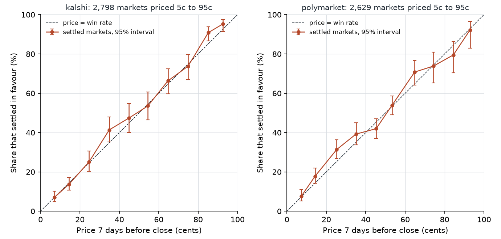
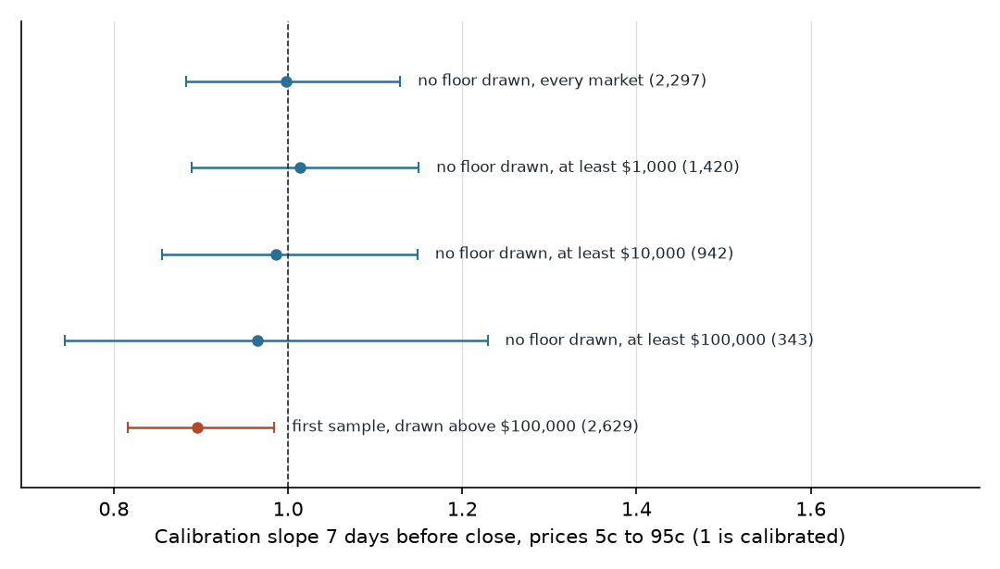
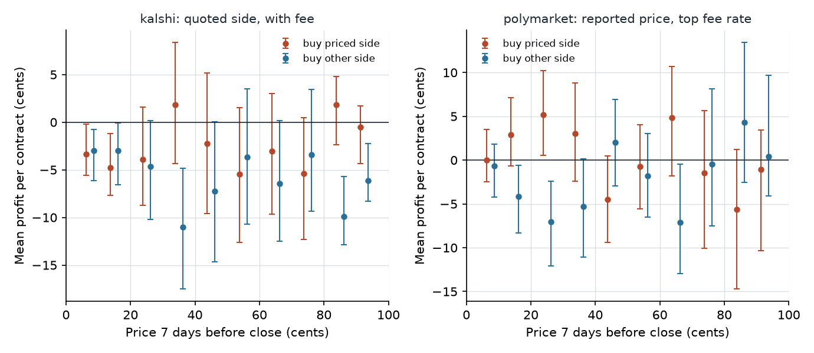
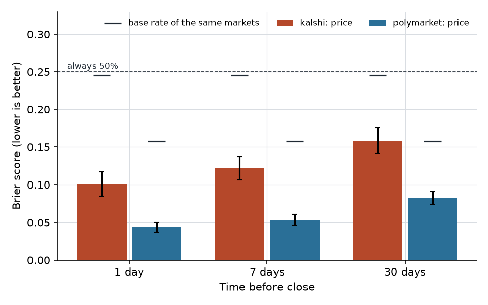

# Plumbline

**When a prediction market says 70%, does it happen 70% of the time?**

On Kalshi, nearly, with a lean in the direction of the favourite-longshot bias. On Polymarket the answer changes with which markets are kept. On neither venue is a gap reliably larger than the cost of trading it.

The numbers below are for markets still priced between 5 and 95 cents seven days before close. I call these live prices. The rest, 43% of Polymarket prices and 24% of Kalshi prices at that horizon, belong to markets that were mostly decided or not trading.

Kalshi, 2,798 markets in 627 series: the calibration slope is 1.07 (0.99 to 1.17), where 1 is calibrated and above 1 is the favourite-longshot bias. The interval includes 1. The Mincer-Zarnowitz slope is 0.037 (-0.009 to 0.081), the same size as the 0.037 that Bürgi, Deng and Whelan report. Contracts priced at 80 cents or more won 4.3 points more often than their price (2.0 to 6.6).

Polymarket, 2,629 markets with at least $100,000 traded: the slope is 0.90 (0.82 to 0.98), which means prices a little too extreme. In a second sample of 2,297 markets drawn with no volume floor the slope is 1.00 (0.88 to 1.13). The slope of the first sample minus the second is -0.10 (-0.26 to 0.05) at seven days and -0.19 (-0.29 to -0.09) at one day.

Costs: after fees, and after the quoted spread on Kalshi, 3 of 120 bin-and-side tests have an interval above zero. A calibrated market with the same prices, costs and clusters gives 0.8 on average and 3 or more in 5% of simulations. None of the three survives a correction for 120 tests. The smallest adjusted p-value is 0.32.



The main limit: traded volume is known only when a market ends. So I cannot tell whether busy Polymarket markets are priced differently or whether a volume floor picks out markets whose longshots came in. The Kalshi interval at seven days still includes 1.

The live-price subset, the second Polymarket sample, the larger Kalshi sample and the test against a simulated calibrated market were all added after the first results had been read, in answer to a review of them. `PAPER.md` lists what was chosen when.

## Reproduce

```
uv sync
uv run python scripts/fetch_data.py
uv run python scripts/reproduce.py
```

`reproduce.py` takes about ten minutes here and rewrites every file in `results/`. Run twice on the same download it gives identical files.

`uv run python scripts/reproduce.py --fast` needs no data and no network. It simulates one fair venue and one with a planted bias, runs the same code on them, and writes to `results_fast/`. CI runs this.

The fetch can be stopped and started again. Each run adds its start, its end and its request count to `data/manifest.json`, and `results/run.json` carries a copy. The first download, on 2026-11-23, ran from 19:26 to 20:08 UTC by the file times. The script of that day did not log sessions or count requests. On 2026-11-24 the no-floor sample took 14,485 requests in 59 minutes and the larger Kalshi sample took 11,871 requests in 66 minutes. One Kalshi session before that was stopped by hand after 13 minutes and its requests were not counted.

A later fetch will not return exactly the same markets, so the numbers will move a little.

## What was found

Intervals are 95%. For slopes, gaps and scores they come from 2,000 bootstrap resamples of whole clusters: events on Polymarket, series on Kalshi. For a win rate in one price bin they are Wilson intervals with the sample size reduced for clustering.

### How much of the sample was already decided

| Venue | Days before close | Markets | Within 2c of 0 or 1 | Outside 5c to 95c | Live markets |
| --- | --- | --- | --- | --- | --- |
| Polymarket, at least $100,000 | 1 | 8,415 | 31% | 37% | 5,307 |
| Polymarket, at least $100,000 | 7 | 4,588 | 34% | 43% | 2,629 |
| Polymarket, at least $100,000 | 30 | 2,036 | 37% | 52% | 980 |
| Polymarket, no floor | 1 | 8,433 | 20% | 27% | 6,168 |
| Polymarket, no floor | 7 | 3,187 | 20% | 28% | 2,297 |
| Polymarket, no floor | 30 | 922 | 26% | 42% | 537 |
| Kalshi | 1 | 6,210 | 6% | 18% | 5,082 |
| Kalshi | 7 | 3,705 | 9% | 24% | 2,798 |
| Kalshi | 30 | 2,352 | 6% | 24% | 1,776 |

In the first Polymarket sample 2,101 of the 4,588 seven-day markets sit below 10 cents, at a mean price of 2 cents. A row like that is nearly always "calibrated" and tells little about the prices in between. Selecting on the price does not bias a statement about the outcome given the price, so the live rows are the main ones and the all-price rows are kept for comparison (`results/extremes.md`).

### The favourite-longshot bias, live prices

| Venue | Days before close | Markets | Clusters | Mean of outcome minus price | Mincer-Zarnowitz slope | Calibration slope |
| --- | --- | --- | --- | --- | --- | --- |
| Kalshi | 1 | 5,082 | 747 | +0.8c (-0.6 to 2.2) | 0.013 (-0.023 to 0.046) | 1.03 (0.97 to 1.09) |
| Kalshi | 7 | 2,798 | 627 | +1.5c (-0.6 to 3.6) | 0.037 (-0.009 to 0.081) | 1.07 (0.99 to 1.17) |
| Kalshi | 30 | 1,776 | 483 | +1.2c (-1.2 to 3.7) | 0.061 (0.003 to 0.111) | 1.11 (1.00 to 1.23) |
| Polymarket, at least $100,000 | 1 | 5,307 | 4,718 | +1.7c (0.5 to 2.9) | -0.076 (-0.124 to -0.028) | 0.88 (0.82 to 0.95) |
| Polymarket, at least $100,000 | 7 | 2,629 | 2,231 | +1.6c (0.0 to 3.2) | -0.065 (-0.128 to -0.004) | 0.90 (0.82 to 0.98) |
| Polymarket, at least $100,000 | 30 | 980 | 745 | -2.2c (-4.7 to 0.2) | -0.063 (-0.147 to 0.019) | 0.92 (0.81 to 1.06) |

A favourite-longshot bias shows as a Mincer-Zarnowitz slope above 0 and a calibration slope above 1.

Every Kalshi estimate points that way and grows with the horizon. At 30 days both intervals exclude the calibrated value, barely. At seven days they include it. Favourites carry the effect: at 80 cents or more they beat their price by 4.3 points at seven days and 5.6 at 30 days (2.6 to 8.2), while contracts under 20 cents are within a point of theirs.

The first Polymarket sample leans the other way at every horizon. The next section asks whether the volume floor produces that.

### The same table on all prices

| Venue | Days before close | Markets | Mincer-Zarnowitz slope | Calibration slope |
| --- | --- | --- | --- | --- |
| Kalshi | 1 | 6,210 | 0.019 (-0.006 to 0.040) | 1.05 (1.00 to 1.11) |
| Kalshi | 7 | 3,705 | 0.035 (0.004 to 0.065) | 1.08 (1.01 to 1.17) |
| Kalshi | 30 | 2,352 | 0.058 (0.017 to 0.094) | 1.15 (1.05 to 1.26) |
| Polymarket, at least $100,000 | 1 | 8,415 | -0.013 (-0.033 to 0.006) | 0.90 (0.85 to 0.96) |
| Polymarket, at least $100,000 | 7 | 4,588 | -0.008 (-0.039 to 0.021) | 0.94 (0.87 to 1.01) |
| Polymarket, at least $100,000 | 30 | 2,036 | -0.047 (-0.098 to 0.000) | 0.95 (0.86 to 1.05) |

Bürgi, Deng and Whelan use all prices, so this is the table to hold against theirs. At seven days they report a Mincer-Zarnowitz slope of 0.037 with a standard error of 0.010 from 7,178 contracts. This sample gives 0.035 (0.004 to 0.065) from 3,705. At one day they report 0.017 and this sample gives 0.019. On all prices the Kalshi sample agrees with the paper. The first version of this study had 791 Kalshi markets at seven days and could not tell.

The dead markets move Polymarket more than Kalshi. With them the Polymarket seven-day slope interval reaches 1.01, and without them it stops at 0.98.

The Kalshi sample is drawn by series, so its intervals resample series. Resampling events instead changes them in the second decimal: the seven-day live slope interval is 0.98 to 1.16 by event and 0.98 to 1.17 by series (`results/clustering.md`).

### Does the volume floor make the Polymarket slope?

The first Polymarket sample keeps markets with at least $100,000 traded by the time they closed. A longshot that comes in draws more trading than one that fades, so a floor on final volume could collect winning longshots and push the slope below 1.

To test it I drew a second sample with no floor: every closed market due to end on 276 days drawn at random, six per month from January 2023 to October 2026, then up to 300 per month of close. It has 8,608 markets. The table applies floors to that one sample afterwards.

| Final volume, no-floor sample | Markets | Priced at exactly 50c | Mean of outcome minus price | Calibration slope |
| --- | --- | --- | --- | --- |
| Every market | 2,297 | 16% | -7.7c (-9.8 to -5.6) | 1.00 (0.88 to 1.13) |
| At least $1,000 | 1,420 | 5% | -1.6c (-3.8 to 0.5) | 1.01 (0.89 to 1.15) |
| At least $10,000 | 942 | 3% | +0.9c (-1.6 to 3.5) | 0.99 (0.85 to 1.15) |
| At least $100,000 | 343 | 3% | +6.0c (1.7 to 10.4) | 0.97 (0.74 to 1.23) |
| Under $1,000 | 877 | 34% | -17.5c (-21.6 to -13.4) | 1.96 (1.39 to 2.99) |
| First sample, drawn above $100,000 | 2,629 | | +1.6c (0.0 to 3.2) | 0.90 (0.82 to 0.98) |

Seven days before close, live prices (`results/volume_floor.md`).



Three things come out of it.

Without the floor the slope is 1.00. At seven days nothing in the no-floor sample is below 1 with any confidence, at any floor.

The evidence that the floor moves the slope is strong at one day and weak at seven. The first sample's slope minus the no-floor sample's is -0.19 (-0.29 to -0.09) at one day, -0.10 (-0.26 to 0.05) at seven and -0.04 (-0.30 to 0.18) at 30. Inside the no-floor sample, markets that ended at or above $100,000 minus those that ended below give -0.23 (-0.40 to -0.06), -0.10 (-0.38 to 0.22) and -0.57 (-0.98 to -0.17). The one-day slope falls step by step as the floor rises: 1.07, 1.03, 0.95, 0.89. All differences are negative. At the horizon I named as the main one the interval includes zero (`results/volume_floor_test.md`).

Markets with almost no trading do not carry a usable price. Under $1,000 of volume, 34% of seven-day prices are exactly 50 cents and the priced side wins 17.5 points less often than its price. That is a quote on an empty book. The row with a $1,000 floor is the cleanest light-floor comparison, and its slope is 1.01.

So the statement that Polymarket prices are too extreme holds for the high-volume sample and does not hold for the market as a whole. This data cannot separate two readings: that the floor selects on the outcome, or that busy markets are priced differently. Both predict a lower slope in high-volume markets. A floor on early volume would separate them, and the public listing gives only the final figure.

One more split, also made after the fact (`results/splits.md`): in the first sample the low slope sits in markets between two named sides, mostly sports matches, at 0.66 (0.45 to 0.89) on 666 live markets. Yes-or-no markets give 0.96 (0.86 to 1.07).

Seven days after a market opened, a moment known in real time, the first sample's live slope is 0.88 (0.81 to 0.97) and Kalshi's is 0.98 (0.91 to 1.06) (`results/longshot_bias_after_open.md`).

### Is any gap bigger than the cost of trading it?

For every price bin, horizon and side, `results/edge_after_costs.md` gives the mean profit per contract of buying and holding to settlement. On Kalshi the buyer pays the quoted ask (or one minus the bid for the other side) plus the taker fee of 0.07 x P x (1 - P). The median quoted spread was 4 cents. On Polymarket the history has one price and no spread, so the test uses that price plus the highest rate in the current fee table, 0.05 x p x (1 - p).



On live prices there are 120 tests. Three have an interval above zero:

| Venue | Days | Trade | Price bin | Markets | Profit per contract | p against a calibrated market | Holm-adjusted p |
| --- | --- | --- | --- | --- | --- | --- | --- |
| Polymarket | 1 | buy the priced side | 10c to 20c | 532 | 3.2c (0.1 to 6.8) | 0.013 | 1.00 |
| Polymarket | 1 | buy the priced side | 20c to 30c | 604 | 4.3c (0.8 to 8.1) | 0.003 | 0.32 |
| Polymarket | 7 | buy the priced side | 20c to 30c | 354 | 5.2c (0.5 to 10.2) | 0.007 | 0.86 |

A calibrated market loses the fee and the spread on average, so its chance of an interval above zero is well under 2.5% a test. I simulated outcomes from a market calibrated at every quoted price, with the same prices, costs and clusters, 10,000 times. It gives 0.8 intervals above zero on average, about 0.7% a test, and three or more in 5.4% of simulations. Treating markets as independent instead of whole clusters gives 0.7 and 3.2% (`results/edge_null.md`).

Three is more than a calibrated market usually gives, and not by enough to rule one out. The tests also overlap: the same markets appear at several horizons and each bin is tested from both sides. The simulation keeps that structure. After a Holm correction for 120 tests no single one stands, with a smallest adjusted p of 0.32.

All three are in the high-volume Polymarket sample, at prices where winning longshots would collect under the volume floor, and with no spread charged. I do not read any of them as a tradeable gap.

The first version listed a fourth hit, Kalshi at 30 days in the 80 to 90 cent bin, where all 31 markets had won and the bootstrap gave an interval of almost no width. The Wilson interval cannot do that. With the larger sample that bin holds 153 markets and makes 3.2c (-2.3 to 6.4).

### Brier score against a naive baseline

| Venue | Days before close | Live markets | Brier score | Always the base rate | Skill, live prices | Skill, all prices |
| --- | --- | --- | --- | --- | --- | --- |
| Kalshi | 1 | 5,082 | 0.165 | 0.245 | 33% (30 to 35) | 43% (40 to 45) |
| Kalshi | 7 | 2,798 | 0.151 | 0.247 | 39% (35 to 43) | 50% (46 to 54) |
| Kalshi | 30 | 1,776 | 0.144 | 0.242 | 40% (35 to 45) | 51% (46 to 55) |
| Polymarket, at least $100,000 | 1 | 5,307 | 0.207 | 0.248 | 17% (15 to 19) | 40% (38 to 42) |
| Polymarket, at least $100,000 | 7 | 2,629 | 0.195 | 0.243 | 20% (17 to 22) | 42% (39 to 44) |
| Polymarket, at least $100,000 | 30 | 980 | 0.157 | 0.222 | 29% (23 to 35) | 48% (42 to 52) |

Prices beat the base rate and the 0.25 of a coin flip at every horizon. On Polymarket about half of the skill measured on all prices came from markets that were already decided. The base rate is computed from the same outcomes it is scored on, which favours the baseline.

The rows hold different markets, because only long-lived markets have a price 30 days out. On the markets that have a price at all three horizons the score improves towards the close, as it should:

| Venue | Markets | 30 days | 7 days | 1 day |
| --- | --- | --- | --- | --- |
| Polymarket, at least $100,000 | 2,010 | 0.082 | 0.053 | 0.044 |
| Kalshi | 991 | 0.158 | 0.122 | 0.101 |



### By category

Seven days before close, live prices (`results/by_category.md`). Categories with fewer than 100 live markets are left out.

| Venue | Category | Markets | Brier score | Skill against the base rate | Calibration slope |
| --- | --- | --- | --- | --- | --- |
| Kalshi | culture | 1,051 | 0.171 | 29% | 0.96 (0.83 to 1.10) |
| Kalshi | politics | 587 | 0.144 | 42% | 1.18 (0.98 to 1.48) |
| Kalshi | economics | 514 | 0.138 | 44% | 1.19 (1.01 to 1.43) |
| Kalshi | sports | 503 | 0.131 | 44% | 1.22 (1.04 to 1.47) |
| Polymarket | sports | 1,515 | 0.219 | 11% | 0.82 (0.68 to 0.96) |
| Polymarket | politics | 644 | 0.159 | 31% | 0.91 (0.77 to 1.09) |
| Polymarket | crypto | 206 | 0.176 | 28% | 1.01 (0.74 to 1.37) |
| Polymarket | other | 103 | 0.184 | 26% | 0.87 (0.54 to 1.41) |
| Polymarket | culture | 101 | 0.140 | 38% | 1.35 (0.87 to 2.14) |

On Kalshi the slope is near 1.2 in sports, economics and politics, and culture, the largest category, pulls the venue's figure down. Sports on Polymarket has the least skill and the lowest slope. These are nine intervals with no correction, and the Polymarket rows are the high-volume sample.

## Which markets have history

- Polymarket price history starts in late 2022. Of 28 sampled markets that closed in 2022, 3 returned any history. From 2023 on, 97% to 100% do. The earliest price in any fetched history is from 2022-11-18.
- For closed Polymarket markets the history endpoint returned points only at a spacing of 12 hours or coarser. So markets that live less than two days cannot be measured, and they are a large group: 45,706 of 110,315 settled markets above the volume floor, 41%, were open for under two days. Most are single sports games and short crypto contracts. Nothing here says anything about them.
- The Polymarket documentation does not say whether the history price is a midpoint or a last trade. There is no bid or ask in it. For a market that has not traded it is often exactly 50 cents.
- Kalshi lists settled markets back to 2021 and serves daily candlesticks with bid and ask. Every one of the 13,224 sampled markets returned candlesticks.
- Kalshi quotes are often one-sided. 2,016 of the 13,224 never had a bid of at least 1 cent and an ask of at most 99 cents within 20 cents of each other on any day. 28% gave a usable price seven days before close, counting the ones that were not open yet.
- Markets that did not settle to one side are counted and left out: 275 of 110,590 in the first Polymarket listing, 8,986 of 565,974 in the no-floor listing, and 2,594 of 236,916 on Kalshi.

The full counts are in `results/sample_funnel.md`, `results/history_reach.md`, `results/coverage.md` and `results/sample_dates.md`.

## Data

Everything comes from public endpoints that need no key and no account. The fetch sends a generic User-Agent and nothing else. Nothing in `data/` is committed.

Polymarket, first sample:

- `GET https://gamma-api.polymarket.com/markets/keyset` for closed markets with at least $100,000 traded and a scheduled end from 2022-10-01 to 2026-10-31. This listed 110,590 markets.
- `GET https://clob.polymarket.com/prices-history` with `interval=max` and `fidelity=720` for 8,600 of them: up to 300 drawn at random per month of close, from markets open at least two days. Their closes run from 2022-06-02 to 2026-11-01.

Polymarket, no-floor sample:

- The same listing with no volume filter, for markets due to end on 276 drawn days and started at least two days before the end of that day. This listed 565,974 markets, of which 398,619 were eligible.
- Price history for 8,608 of them, up to 300 per month of close. 53 histories came back empty.

Kalshi, all under `https://api.elections.kalshi.com/trade-api/v2`:

- `GET /series` for the 16,793 series. 600 were drawn at random for the first version and 1,800 more from the rest afterwards, 2,400 in all.
- `GET /historical/markets` and `GET /markets?status=settled` for the settled markets of those series that closed before 2026-11-01. 1,419 of the 2,400 had any, 236,916 markets in all.
- `GET /historical/markets/{ticker}/candlesticks` and `GET /series/{series}/markets/{ticker}/candlesticks`, daily, for 13,224 markets: up to 25 drawn per series from binary markets with at least 100 contracts traded and open at least two days. Their closes run from 2021-07-25 to 2026-10-31.

Skipped:

- Manifold. It is play money, so fees and trading costs do not apply, and I left it out to keep to two venues.
- Trade-level data on either venue. The paper used Kalshi trades obtained with a registered account. This project uses only what is served without one.
- Kalshi's fee schedule PDF. The site answered automated requests with HTTP 429, so the fee formula is taken from the paper and from the fee fields in the public series record.

Requests were spaced 0.2 seconds apart for Polymarket. For Kalshi they were 0.5 seconds apart on the first day and 0.25 on the second. Requests that hit a rate limit or a server error are retried with backoff, and none failed after retries. Both venues publish their data under their own terms of use. Read them before using the data for anything else.

## How it is tested

103 tests, none of which touch the network.

- A simulated market that is calibrated by construction comes out calibrated, on all prices and on live prices.
- A planted longshot bias is recovered with the right sign and size.
- No market is counted before it has settled, and a split or void market is never scored.
- A quote from after the chosen moment never changes an observation.
- The Brier partition sums to the Brier score exactly, and fee formulas match worked values.
- A bootstrap that ignores events is too narrow by the factor theory says, and the one used here is not.
- The Wilson interval matches the textbook value, covers a known win rate about 95% of the time under clustering, and has width when all 31 of 31 markets won.
- Simulated outcomes from a calibrated market win at their prices, and beat their costs far less often than 2.5% of the time.
- Adding series to the Kalshi draw leaves the first draw and its markets unchanged.
- `reproduce.py --fast` run twice gives identical files.

```
uv run pytest
uv run ruff check .
uv run mypy src
```

## Layout

```
src/plumbline/         the code
tests/                 maths tests first
scripts/fetch_data.py  downloads public data into data/ (never committed)
scripts/reproduce.py   rebuilds every figure and table
results/               committed figures and small tables
PAPER.md               sources, formulas, comparison, and what was chosen when
```

## Limits

- Volume on Polymarket is known only at the end. Every volume cut here, including the tiers inside the no-floor sample, conditions on something the outcome can affect. The no-floor row with every market in it is the only one free of that, and it contains markets with no real price.
- The no-floor sample lists six days a month. It is a sample of days, and markets due on the same day share whatever happened that day. The bootstrap resamples events and does not account for that.
- 148 of the 2,297 live seven-day markets in the no-floor sample are also in the first sample. The comparison treats the two as independent.
- At seven days the Kalshi live-price interval includes the calibrated value. The all-price interval excludes it. The claim that Kalshi shows the bias rests on the point estimate matching the paper and on the 30-day rows.
- The Kalshi sample is drawn by series, with at most 25 markets from each. It weights a series with 30 markets the same as one with 4,000, so it is not a picture of Kalshi's volume.
- Requiring a two-sided Kalshi quote drops the cheapest contracts, those bid below one cent. The paper finds its largest losses in contracts under 10 cents, so this filter removes part of where the bias would be.
- "Days before close" is measured from a close that may have come early. A market that settles early on an event is sampled in the days just before that event. Seven days after open does not have this problem and is reported next to it.
- The 5 and 95 cent bounds were chosen after the first results were read. Other bounds were not tried.
- The simulated calibrated market shares one random draw across a whole cluster, which is the strongest positive dependence that calibrated prices allow. Real events with mutually exclusive outcomes are negatively dependent. The version with independent markets is reported beside it.
- Polymarket has no spread in its history, so its costs are understated. Its fees are the current published table applied to all years. I could not find when fees began, and most of the sample period may have had none.
- The Kalshi fee is the large-order rate. A small order pays more because the total is rounded up to a cent.
- Outside the cost tests, intervals are not corrected for how many are reported. A few will exclude their null value by chance.
- Both samples are mostly 2025 and 2026, because that is when most markets were listed.
- This reads public data only. It places no orders and needs no account. It is research code and not investment advice.

## Sources

- Wolfers and Zitzewitz, "Prediction Markets", Journal of Economic Perspectives 18(2), 2004.
- Bürgi, Deng and Whelan, "Makers and Takers: The Economics of the Kalshi Prediction Market". I read the George Washington University working paper 2026-001 (February 2026) and the CESifo working paper 12122. The CEPR discussion paper 20631 is the same paper and I did not fetch that copy.

`PAPER.md` has the formulas with their locations in the sources, the comparison claim by claim, and every variant tried.

The name: a plumb line tells you whether a wall is true.

## Licence

MIT. See `LICENSE`.
